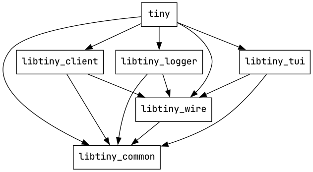

# Architecture

This document describes tiny's high-level architecture, the parts that are
unlikely to change often, with the rationale behind some of the design
decisions. If you are interested in contributing to tiny, this is the best
place to start.

## Crates

tiny consists of 6 crates. The dependencies between these crates are as
follows:

Separation to smaller crates was mainly motivated by two things:

- `libtiny_client` is reusable outside of tiny. More details are in the
  individual crate sections below.

- Rust allows recursive imports within a crate and over time tiny started to
  become a big crate where everything depended on everything else. Separation
  to crates makes separating concerns easier and dependencies between
  modules/crates and crate interfaces become clear.

Unfortunately this makes it difficult to publish tiny on crates.io (#257). We
currently do not publish tiny on crates.io.

Below are the crates in more detail:

### tiny

`tiny` is the main crate that provides the `tiny` executable. It brings
everything together.

- Implements command-line interface (CLI) and command-line argument parsing
- Implements config file parsing
- Initializes loggers (both debug logging and message logging)
- Initializes tokio runtime and creates clients
- Initializes TUI
- Implements updating the TUI on client events (e.g. to show an incoming
  message on TUI). This is implemented in module `conn`.
- Implements updating clients on TUI events (e.g. to send a message when the
  user enters a message in the TUI). This is implemented in module `ui`.

#### Dependencies of `tiny`:

| Dependency     | Used for      |
| -------------- | ------------- |
| libtiny_client | Managing IRC connections (maintaining conns, getting incoming msgs, sending msgs, ...) |
| libtiny_tui    | Drawing the UI on the terminal |
| libtiny_logger | User and server message logging (not debug logging) |
| libtiny_wire   | For IRC message definitions (types), used to handle incoming IRC messages |
| libtiny_common | The "channel name" type |

### libtiny_client

Provides three key types to create and maintain an IRC connection:

- `ServerInfo`: encapsulates information to connect to an IRC server and
  maintain the connection (server address/port, NickServ/SASL/etc.
  credentials, nicks, ...).

- `Event`: an enum type for IRC events ("connected", "message received" etc.)

- `Client`: the connection handle type. Users create a `Client` by providing a
  `ServerInfo`. `Client` then maintains the connection (handles timeouts,
  disconnects, nick selection and identification etc. everything needed to keep
  the connection alive).

  Note that a client maintains one connection. If you want to connect to N
  servers you need N `Client`s.

  `Client::new()` also returns a tokio channel receiver for `Event`s. IRC
  events are passed to users via this channel. `tiny`'s `conn` module
  implements the handler for these events.

  The `Client` itself can be used to send messages, joining channels etc.

#### Dependencies of `libtiny_client`:

| Dependency     | Used for      |
| -------------- | ------------- |
| libtiny_wire   | IRC message parsing and generation|
| libtiny_common | The "channel name" type |

### libtiny_tui

Handles user input and drawing the terminal UI (TUI). At a high-level the API
is very similar to `libtiny_client`: on initialization the user passes a config
(file path for the tiny config file), `libtiny_tui` returns two tokio channel
for user input events and a TUI handle to update the TUI. The types are:

- `Event`: Enum for TUI events like a message submitted by the user, or an exit
  request.

- `TUI`: The type to modify TUI (create tabs, show messages etc.)

Ratatui renders the same UI state through either a Crossterm terminal or its
test backend. A dedicated input thread delivers Crossterm events in order.
After a standalone Escape, that thread temporarily reads raw terminal bytes
and reparses the fragmented sequence with termwiz; otherwise Crossterm could
discard a split bracketed-paste terminator. Pending input survives an editor
handoff. When the editor runs, terminal modes are restored and IRC updates
continue to change state; the screen is redrawn when the terminal resumes.

#### Dependencies of `libtiny_tui`:

| Dependency     | Used for      |
| -------------- | ------------- |
| crossterm | Terminal modes and input events |
| ratatui | Layout and terminal rendering |
| termwiz | Reparse fragmented escape sequences |
| libtiny_common | The "channel name" type |
| libtiny_wire   | Parsing IRC message formatting characters (colors etc.) |

### libtiny_logger

Implements logging IRC events (incoming messages, user left/joined etc.) to
user-specified log directory.

#### Dependencies of `libtiny_logger`:

| Dependency     | Used for      |
| -------------- | ------------- |
| libtiny_common | The "channel name" type |
| libtiny_wire   | Filtering out IRC message formatting characters (colors etc.) |

### libtiny_wire

Implements IRC message parsing and generation. Entry point for parsing is
`parse_irc_msg`, which returns at most one `Msg`, which is the type for IRC
messages.

For message generation, we only have a few functions like `privmsg`, `join`
etc. for the messages we need in tiny.

#### Dependencies of `libtiny_wire`:

| Dependency     | Used for      |
| -------------- | ------------- |
| libtiny_common | The "channel name" type |

### libtiny_common

This crate currently has just one type: `ChanName`, which is the type for
channel names.

RFC 2812 has two rules related to character names:

- Channel names are case insensitive
- The characters "{}|^" are considered lowercase, and their uppercase
  equivalents are "[]\\~".

There's also a rule implemented by servers:

- For non-ASCII characters the comparison is *case sensitive*.

The `ChanName` type provides a newtype with comparison implementation that
follows these rules.

Because channel names are widely used in the implementation of tiny, all other
tiny crates need the `ChanName` type. To avoid introducing dependencies between
large crates just for one type, we have this crate.

`libtiny_common` does not depend on other tiny crates.

